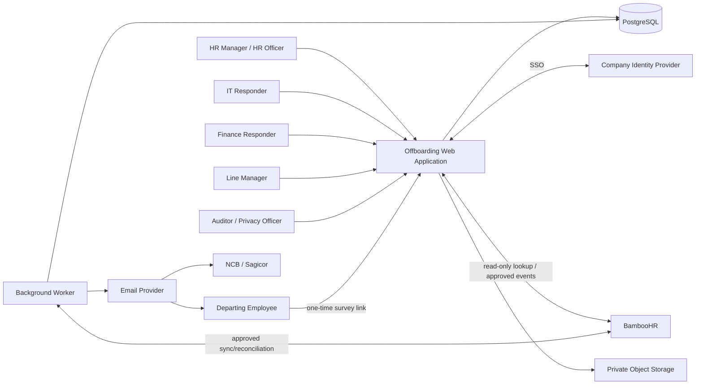

# Architecture

## 1. Architecture objective

Provide a secure, maintainable internal offboarding product for low operational volume and high confidentiality. The architecture prioritizes auditability, correctness, least privilege and operational simplicity over distributed scale.

## 2. Chosen style

**Modular monolith with a separate background worker and PostgreSQL transactional outbox.**

This is appropriate because:

- source volume is approximately three cases per month;
- the process has strong transactional relationships;
- one team/developer initially owns the product;
- microservices would multiply deployment, security, observability and consistency risk;
- asynchronous email, reminders, retention and integration work still benefits from a dedicated worker.

## 3. System context



## 4. Logical containers

### Web application

Responsibilities:

- authenticated internal UI;
- public-but-token-protected survey UI;
- server-side authorization;
- case, task, document, asset, handover and report operations;
- transactional creation of outbox work;
- administration and audit views.

The web process must not perform fragile long-running dispatch or scheduling directly in a browser request.

### Background worker

Responsibilities:

- scheduled task readiness/reminders/escalations;
- notification dispatch and retry;
- survey invitation/reminder jobs;
- integration synchronization and reconciliation;
- document post-processing if asynchronous;
- retention/disposal jobs after approval;
- monitoring heartbeat and dead-letter/error handling.

### PostgreSQL

Authoritative operational store for:

- business state;
- immutable histories;
- workflow/template versions;
- approvals;
- outbox and job state;
- sanitized integration metadata;
- audit events;
- configuration.

Use transactions and constraints to enforce exactly-once logical effects where possible.

### Private object storage

Stores:

- uploaded source documents;
- issued PDFs/DOCX;
- task evidence;
- export artefacts with short retention.

Objects are not publicly enumerable. Access is always authorized through the application or short-lived scoped URLs.

### External adapters

- Identity adapter.
- BambooHR employee-source adapter.
- Email-provider adapter.
- Object-storage adapter.
- Malware-scanner adapter.
- Optional future AI adapter, disabled until approval.

## 5. Repository shape

```text
apps/
  web/
  worker/

packages/
  auth/
  config/
  database/
  domain/
  workflows/
  documents/
  notifications/
  integrations/
  reporting/
  ui/
  validation/
  observability/
  testing/

docs/
  ...
```

The exact package count may be simplified, but domain boundaries must remain clear.

## 6. Domain modules

| Module | Responsibilities | Must not own |
| --- | --- | --- |
| Identity and Access | Authentication, effective permissions, record access, role assignment | HR workflow decisions |
| Employee Source | Source lookup, cache, snapshot inputs, sync/reconciliation | Case truth after snapshot approval |
| Cases | Departure record, dates, classification, lifecycle, participants | Task execution logic |
| Workflows | Definitions, instances, tasks, dependencies, due dates, escalation | Email-provider calls |
| Documents | Templates, validation, rendering, approvals, issue/supersession | HR legal wording creation |
| Notifications | Templates, approval, outbox, recipients, attempts, fallback | Workflow business decisions |
| Assets | Catalogue, issued assets, dispositions, evidence | Payroll deductions |
| Handover | Plans, items, owners, risks, attestation | Secret storage |
| Exit Feedback | Survey versions, invitations, tokens, responses, aggregate access | Broad manager access |
| Reporting | KPI calculations, dashboards, exports, suppression | Mutable operational truth |
| Audit and Governance | Audit events, decisions/config history, access review | Editing domain records |
| Integrations | Provider-specific translation and resilience | Core business rules |
| Administration | Versioned business configuration and technical health | Generic unrestricted record editing |

## 7. Request and authorization flow

1. authenticate internal user through the identity provider;
2. resolve effective roles and scopes;
3. load the requested record with a server-side authorization predicate;
4. validate input schema;
5. execute a domain command that checks state and business rules;
6. persist state, history, audit and outbox records in one transaction;
7. return a safe result/reference;
8. worker performs asynchronous effects and appends attempts/events.

Every list query must apply the same record-level restrictions as detail queries.

## 8. Transaction pattern

For a state-changing operation such as approving a case:

```text
BEGIN
  lock/check case version and current state
  validate transition and authority
  create employee snapshot
  set case status
  append status history
  instantiate pinned workflow exactly once
  create tasks
  append audit event
  create any outbox/scheduled events
COMMIT
```

Use optimistic concurrency/version columns or equivalent to prevent lost updates.

## 9. Outbox and jobs

- Domain transactions write outbox events.
- Worker claims rows using safe locking.
- Every handler uses an idempotency key.
- Success records completion/provider reference.
- Transient failure schedules bounded retry.
- Permanent failure creates an exception/dead-letter state.
- Operations dashboard shows queue depth, age and last success without exposing HR content.

## 10. Time model

- Store timestamps in UTC.
- Display and business rules use `America/Jamaica`.
- Store the calendar version and original/current due timestamps.
- Exact separation time is an instant.
- A “business day” deadline is computed from the configured work calendar, not by adding 24 hours.
- Worker clocks are not accepted as proof without persisted timestamps.

## 11. File model

1. upload to quarantine with generated object key;
2. validate extension, MIME, magic bytes and size;
3. scan using the approved scanner boundary;
4. mark CLEAN or REJECTED;
5. only CLEAN files can be viewed/used;
6. every access is authorized;
7. issued document bytes are immutable;
8. retention/deletion operates by record class and legal hold.

## 12. Reporting model

Operational reports query authoritative transactional data or controlled database views. For higher complexity, introduce materialized views/read models inside the same PostgreSQL environment before considering a separate analytics platform.

Metrics must be implemented from the metric dictionary and tested with synthetic boundary cases.

## 13. Deployment baseline

The final platform is an IT decision, but production must provide:

- company-owned identity and secrets;
- isolated environments;
- managed or operationally owned PostgreSQL;
- private object storage;
- TLS;
- scheduled worker;
- backup/restore;
- logging/metrics/alerts;
- migration and rollback process;
- outbound email controls;
- no production data in lower environments.

## 14. Deliberate exclusions

- no microservices;
- no event broker required initially beyond PostgreSQL outbox;
- no direct payroll calculation;
- no broad data lake;
- no production AI dependency;
- no public employee portal beyond token-protected survey;
- no generic admin CRUD over business tables.
