# Logical Data Model

## 1. Purpose

This is a technology-neutral logical model for the first implementation. Claude may translate it into Prisma models only in the authorized schema directive. Names can be refined, but required relationships, history and security boundaries must be preserved.

## 2. Core relationship diagram

```mermaid
erDiagram
    USER ||--o{ ROLE_ASSIGNMENT : has
    USER ||--o{ CASE_PARTICIPANT : participates
    USER ||--o{ TASK_INSTANCE : assigned
    USER ||--o{ APPROVAL : decides
    USER ||--o{ AUDIT_EVENT : acts

    EMPLOYEE_SOURCE_RECORD ||--o{ EMPLOYEE_SNAPSHOT : supplies
    EMPLOYEE_SNAPSHOT ||--|| OFFBOARDING_CASE : captured_for

    OFFBOARDING_CASE ||--o{ CASE_STATUS_HISTORY : records
    OFFBOARDING_CASE ||--o{ CASE_PARTICIPANT : includes
    OFFBOARDING_CASE ||--o{ STORED_FILE : attaches
    OFFBOARDING_CASE ||--|| WORKFLOW_INSTANCE : instantiates
    OFFBOARDING_CASE ||--o{ GENERATED_DOCUMENT : contains
    OFFBOARDING_CASE ||--o{ NOTIFICATION : contains
    OFFBOARDING_CASE ||--o{ CASE_ASSET : tracks
    OFFBOARDING_CASE ||--o| HANDOVER_PLAN : may_have
    OFFBOARDING_CASE ||--o{ SURVEY_INVITATION : may_have
    OFFBOARDING_CASE ||--o{ EXCEPTION : raises

    WORKFLOW_DEFINITION ||--o{ WORKFLOW_DEFINITION_VERSION : versions
    WORKFLOW_DEFINITION_VERSION ||--o{ TASK_DEFINITION : contains
    WORKFLOW_DEFINITION_VERSION ||--o{ WORKFLOW_INSTANCE : instantiates
    WORKFLOW_INSTANCE ||--o{ TASK_INSTANCE : contains
    TASK_DEFINITION ||--o{ TASK_INSTANCE : instantiates
    TASK_INSTANCE ||--o{ TASK_DEPENDENCY : depends
    TASK_INSTANCE ||--o{ TASK_EVIDENCE : evidences
    TASK_INSTANCE ||--o{ EXCEPTION : raises

    DOCUMENT_TEMPLATE ||--o{ DOCUMENT_TEMPLATE_VERSION : versions
    DOCUMENT_TEMPLATE_VERSION ||--o{ GENERATED_DOCUMENT : renders
    GENERATED_DOCUMENT ||--o{ APPROVAL : requires
    GENERATED_DOCUMENT ||--o{ STORED_FILE : outputs
    GENERATED_DOCUMENT ||--o| GENERATED_DOCUMENT : supersedes

    NOTIFICATION_TEMPLATE ||--o{ NOTIFICATION_TEMPLATE_VERSION : versions
    NOTIFICATION_TEMPLATE_VERSION ||--o{ NOTIFICATION : renders
    NOTIFICATION ||--o{ NOTIFICATION_RECIPIENT : has
    NOTIFICATION ||--o{ NOTIFICATION_ATTEMPT : attempts
    NOTIFICATION ||--o{ APPROVAL : requires
    NOTIFICATION ||--o{ OUTBOX_EVENT : dispatches

    ASSET_TYPE ||--o{ EMPLOYEE_ISSUED_ASSET : classifies
    EMPLOYEE_ISSUED_ASSET ||--o{ CASE_ASSET : seeds
    ASSET_TYPE ||--o{ CASE_ASSET : classifies
    CASE_ASSET ||--o{ STORED_FILE : evidences
    CASE_ASSET ||--o{ WAIVER : may_have

    HANDOVER_PLAN ||--o{ HANDOVER_ITEM : contains
    HANDOVER_PLAN ||--o{ APPROVAL : attests

    SURVEY_DEFINITION ||--o{ SURVEY_DEFINITION_VERSION : versions
    SURVEY_DEFINITION_VERSION ||--o{ SURVEY_QUESTION_VERSION : contains
    SURVEY_DEFINITION_VERSION ||--o{ SURVEY_INVITATION : uses
    SURVEY_INVITATION ||--o| SURVEY_RESPONSE : receives
    SURVEY_RESPONSE ||--o{ SURVEY_ANSWER : contains
    SURVEY_QUESTION_VERSION ||--o{ SURVEY_ANSWER : answers

    EXCEPTION ||--o{ EXCEPTION_HISTORY : records
    EXCEPTION ||--o| WAIVER : may_resolve

    HOLIDAY_CALENDAR ||--o{ HOLIDAY : contains
    RETENTION_POLICY ||--o{ RETENTION_POLICY_VERSION : versions
    LEGAL_HOLD }o--o{ OFFBOARDING_CASE : covers

    INTEGRATION_CONNECTION ||--o{ INTEGRATION_EVENT : produces
    OUTBOX_EVENT ||--o{ IDEMPOTENCY_RECORD : protects
```

## 3. Entity groups

### Identity and authorization

#### `User`

- `id`
- `identitySubject`
- `displayName`
- `workEmail`
- `status`
- timestamps

#### `RoleAssignment`

- `userId`
- `role`
- structured scope
- effective dates
- granted/approved by
- reason
- revoked metadata

No role assignment can grant unrestricted generic database access.

#### `CaseParticipant`

Explicit participants for restricted/assigned case access.

### Employee source

#### `EmployeeSourceRecord`

A local cache/reference, not the final case truth. Store only approved fields.

#### `EmployeeSnapshot`

Immutable approved subset. Suggested design:

- one snapshot per approved case;
- structured typed columns for frequently queried fields;
- optional encrypted JSON for the exact approved source subset;
- source and retrieval metadata;
- checksum/version.

### Case

#### `OffboardingCase`

Suggested important constraints:

- unique `caseNumber`;
- one active `employeeSnapshotId`;
- enum departure type/cohort/status/classification;
- `effectiveSeparationAt` required before approval;
- optimistic `version`;
- no cascade hard delete.

#### `CaseStatusHistory`

Append-only transition record with actor, reason, timestamp and correlation ID.

### Workflow

Separate definition/version from instances.

#### `WorkflowDefinition`

Stable code and departure type.

#### `WorkflowDefinitionVersion`

- version number;
- status DRAFT/APPROVED/ACTIVE/RETIRED;
- effective date;
- configuration checksum;
- approval metadata.

#### `TaskDefinition`

Each version includes task codes. Do not reuse a task-definition row across mutable versions.

#### `WorkflowInstance`

Unique per case. Pin definition version.

#### `TaskInstance`

- task definition reference;
- current state;
- queue/assignee;
- original/current due time;
- ready/started/completed times;
- blocker/waiver references;
- optimistic version.

#### `TaskDependency`

Prefer explicit predecessor instance relationships generated at instantiation.

### Documents/files

#### `StoredFile`

Stores metadata and provider key; object bytes live in private storage.

Important fields:

- classification;
- purpose;
- scan status;
- hash;
- immutable flag;
- retention class;
- source object.

#### `DocumentTemplateVersion`

Store template bytes/markup, placeholder schema, render engine version and approval.

#### `GeneratedDocument`

Store exact data snapshot, status, issued file and supersession chain.

#### `SignatureRequest` (DEC-068)

One signer, one form version, one link.

Important fields:

- signer role, name and destination (the destination is masked everywhere it
  is displayed outside the control where HR types it);
- status: PENDING / SIGNED / REVOKED / EXPIRED;
- `tokenHash` — sha256 of the signing token, unique, the lookup key;
- `tokenCiphertext` — the same token under the platform's AES-256-GCM box, so
  the one link can be copied and re-sent; destroyed at every terminal state,
  while the hash is retained so a returning signer gets an accurate message;
- issue and expiry instants, and the extension count;
- the blocks this signer must complete, frozen when the request was made;
- delivery evidence: last sent, send count, masked destination;
- completion evidence: first opened, signed at, the declaration text and
  instant, a hashed client address and a truncated user agent (supporting
  evidence only, never identification on its own).

#### `SignatureRecord` (DEC-068)

One applied mark. The image lives in private object storage; this row is the
record that proves who applied it.

Important fields:

- case, form version and (for a link signature) the request;
- signer reference, name and role; a user id for an HR signer, the request id
  for an external one;
- signature type (INITIALS / SIGNATURE), block key and label;
- provenance (DRAWN / TYPED);
- storage key, sha256 checksum, media type and pixel size;
- signed instant;
- supersession: instant, reason and actor. A mistaken mark is superseded, not
  deleted, and the "one live mark per block" uniqueness is a partial index on
  `supersededAt IS NULL`.

#### `DocumentRevision` (DEC-069)

One revision of an editable document: which record it belongs to (letter,
action form version, receipt version, email), a running revision number,
the kind of change, the editable content as it stood, its checksum, the
editor and the instant. Append-only: the runtime role inserts and reads; a
trigger refuses UPDATE and DELETE.

Related additions: `DocumentInstance.editedBody/editedById/editedAt` (HR's
wording in the template's format); `NotificationRecord.auto*` (the
hierarchy's resolved recipient), `recipientOverride*`, `hrNote`,
`editedById/At`, `correctsRecordId`; `ReturnItemsChecklist.version`,
`lifecycle`, `hrNotes`, `finalized*`, `pdf*`, `supersededReason`, with a
`(caseId, version)` unique in place of one row per case;
`ReturnItemsChecklistEntry.quantity`, `condition`, `returnedAt`,
`assetReference`, `custom`, and a nullable `itemKey` for added rows;
`SignatureRequest`/`SignatureRecord.documentKind` and `checklistId`, so
signatures bind to a form version or a receipt version.
### Notifications

#### `Notification`

A business object independent from provider attempt.

Key fields:

- case/type/template version;
- status;
- applicability evaluation;
- due/schedule/approval/submission times;
- content snapshot;
- idempotency key;
- manual fallback metadata.

#### `NotificationAttempt`

Append-only provider attempt. Avoid storing full body if already captured on Notification.

#### `OutboxEvent`

Generic persisted work with:

- topic;
- aggregate reference;
- deduplication key;
- available time;
- attempt count;
- lease/lock metadata;
- result/dead-letter status.

### Assets

`EmployeeIssuedAsset` can be synchronized or manually imported. `CaseAsset` is the case-specific item and owns disposition evidence.

Do not model a payroll-deduction foreign key or automatic effect.

### Handover

Use structured item categories but allow limited restricted description. Consider document-location references instead of copied documents.

### Survey

#### `SurveyInvitation`

- eligibility/outcome;
- verified channel;
- token hash and expiry;
- send/reminder/suppression/revocation;
- delivery evidence.

#### `SurveyResponse`

One final response per invitation. For HR interview/verbal routes, allow no external token.

#### `SurveyAnswer`

Store answers with question-version references so reports remain interpretable after survey changes.

### Exceptions and waivers

`Exception` is an owned control item. `Waiver` is an approval record, not simply a task status string.

### Audit

`AuditEvent` is append-only and should contain:

- stable event type;
- actor type/id;
- case/object references;
- action result;
- safe metadata;
- occurred time;
- request/correlation ID;
- source IP/device data only if approved and necessary.

Do not copy sensitive document/survey content into audit metadata.

## 4. Indexing considerations

Expected useful indexes:

- case number;
- employee source ID plus active/received date;
- case status/owner/effective date/cohort;
- task status/assignee/role queue/due date;
- exception status/owner/severity/due date;
- notification status/scheduled time/idempotency key;
- survey invitation token hash and schedule;
- audit event case/object/actor/time;
- outbox status/available time;
- document/notification template type and active version.

## 5. Deletion and referential integrity

- case records: no operational cascade deletion;
- issued documents, audit, attempts and histories: immutable, retained by policy;
- source cache may refresh, snapshot remains;
- legal hold blocks policy disposal;
- disposal jobs anonymize/delete by record class in a controlled order;
- object deletion and database disposition must be reconcilable.

## 6. Encryption and sensitive columns

The hosting platform provides encryption at rest. Application-level field encryption may be considered for personal email, survey free text and other highest-risk fields after threat/performance/operations review. Key management must be external to the database.

Do not invent custom cryptography.
