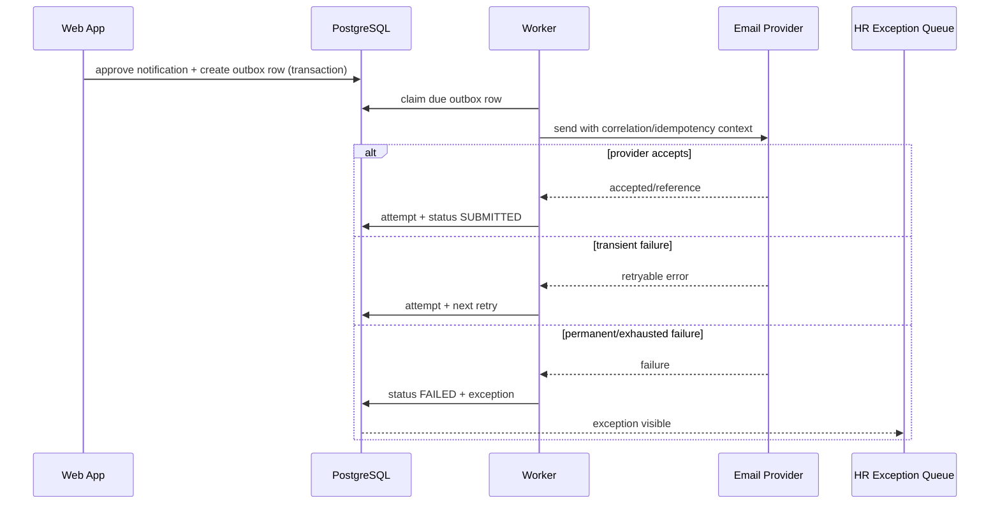

# Document and Notification Design

## 1. Purpose

The DMAIC describes “AI-generated” letters and emails. The product baseline instead uses controlled templates, explicit data mapping, preview, approval and reliable dispatch. This meets the speed and consistency objective with lower privacy, legal and operational risk.

## 2. Controlled template model

Each template type has immutable versions.

Required metadata:

- stable template code;
- document/notification type;
- supported departure types;
- owner;
- classification;
- language/locale;
- effective date;
- status;
- placeholder schema;
- approved recipient/purpose for notifications;
- render channel/format;
- approver and approval time;
- source/legal/policy version reference;
- checksum.

Configuration status:

```text
DRAFT -> PENDING_APPROVAL -> APPROVED -> ACTIVE -> RETIRED
```

Only active versions are selected for new work.

## 3. Placeholder schema

Example:

```yaml
template_code: RESIGNATION_ACKNOWLEDGEMENT
version: 1
classification: RESTRICTED_HR
placeholders:
  employee_full_name:
    type: string
    required: true
    source: employee_snapshot.full_name
  employee_address_block:
    type: multiline_string
    required: false
    source: case.approved_address
    visibility: HR_ONLY
  received_date:
    type: date
    required: true
    source: case.received_at
    format: "MMMM d, yyyy"
  confirmed_last_working_date:
    type: date
    required: true
    source: case.confirmed_last_working_date
  signatory_name:
    type: string
    required: true
    source: template_signatory_config
```

Rules:

- placeholders are allow-listed;
- template code cannot execute arbitrary code;
- required fields block generation;
- date/currency formatting is explicit;
- HTML/text output is context-encoded;
- source and rendered value are shown during approval;
- sensitive optional fields must not appear unless the template explicitly permits them.

## 4. Document lifecycle

1. user selects eligible document type;
2. system resolves active template version pinned to case/workflow;
3. validation checks required fields and departure compatibility;
4. system renders a preview;
5. user submits for approval;
6. approver reviews content, sources and classification;
7. approval creates immutable rendered bytes;
8. issue records file hash, template/data versions and actor/time;
9. optional notification attaches or links the issued document;
10. corrections create a new document and supersession chain.

## 5. Document types

Initial controlled types:

- resignation acknowledgement/acceptance;
- immediate-resignation acknowledgement;
- termination document placeholder pending approved wording;
- digital Employee Action Form;
- asset acknowledgement/clearance summary;
- final offboarding clearance summary.

The system must not invent termination wording.

## 6. Digital Employee Action Form

The source image on page 23 contains multiple HR actions, prior/new status, pay information, checklist and approval lines. For this offboarding product:

- preserve the existing resignation/termination approval authority;
- capture only fields required for offboarding;
- use structured data and authenticated attestations;
- provide an export/print view approximating the current approved form if required;
- do not expose salary/pay fields to roles that do not need them;
- do not treat the form as the sole source of task completion when the platform has more precise evidence;
- changes to signatories require change control.

## 7. Notification composition

A notification is prepared from:

- approved notification template version;
- approved recipient configuration;
- case/employee snapshot and task facts;
- applicability result;
- scheduled/due time;
- approved attachments;
- content/recipient snapshot.

The preview must show:

- To/CC/BCC;
- purpose and classification;
- employee/case identifier appropriate to the recipient;
- effective date/time;
- template version;
- attachments;
- scheduled send time;
- fields omitted due to minimization.

## 8. Approval model

### Human approval required in MVP

- employee-facing messages;
- NCB/Sagicor/external providers;
- termination-related messages;
- letters/documents;
- corrected/resend messages;
- any manual free-form exception.

### Potentially automatic after approved workflow activation

- internal task reminders;
- escalation reminders;
- survey day-7 reminder;
- technical notifications with no additional sensitive content.

Even automatic messages use approved templates, recipient configuration, outbox and audit.

## 9. Notification outbox

Logical flow:



## 10. Idempotency

Recommended logical key:

```text
case_id
+ notification_type
+ recipient_normalized
+ workflow_version
+ effective_event_version
+ dispatch_sequence
```

A deliberate resend increments `dispatch_sequence` and requires reason/approval.

## 11. Attempt and delivery evidence

Store:

- attempt number;
- started/completed time;
- provider;
- provider reference;
- response category/status;
- retryable flag;
- sanitized error;
- next retry;
- correlation ID.

Business status mapping:

| Provider/result | Domain status |
| --- | --- |
| Draft only | DRAFT/PENDING_APPROVAL |
| Approved for future | SCHEDULED |
| Worker claimed | QUEUED |
| API accepted (for example HTTP 202) | SUBMITTED |
| Confirmed delivery signal | DELIVERED_IF_KNOWN |
| Bounce/non-delivery signal | BOUNCED |
| Permanent/exhausted failure | FAILED |
| HR recorded manual send | linked MANUAL_FALLBACK evidence |

## 12. Minimum-data field matrices

### IT access-removal notification/task

Allowed baseline fields:

- employee name;
- employee number/work identity where needed;
- department/location;
- exact effective revocation time;
- systems/accounts/technology assets;
- task/case reference.

Not allowed by default:

- resignation letter;
- personal email/address;
- exit reason/free text;
- survey data;
- pay/benefit data;
- rehire eligibility.

### Finance task

Allowed baseline fields:

- employee identity/number;
- approved departure type category where needed;
- confirmed last day/effective date;
- pay-cycle/reference fields approved by Finance;
- authorized exception decision reference.

Not allowed by default:

- exit feedback;
- broad HR notes;
- technology access details.

### NCB/Sagicor

Allowed field set is OPEN pending owner/privacy approval. Recommended minimum:

- employee identifier/name required by provider;
- programme/group reference;
- approved effective removal date;
- company contact/reference.

No reason, survey data or unrelated contact details.

## 13. Content correction and recall

- submitted email cannot be edited in place;
- corrections use an explicit correction/resend notification;
- the original remains in history;
- recipient impact is assessed;
- an exception records wrong recipient/content;
- template/integration may be suspended if systemic;
- manual recalls are not represented as guaranteed successful unless evidence exists.

## 14. Optional AI assistance

AI may later propose:

- placeholder values extracted from uploaded text;
- draft wording within approved template slots;
- de-identified aggregate themes.

The system must visually distinguish suggestions from approved data/content. Human confirmation writes the final value; the AI output itself is not authoritative.
