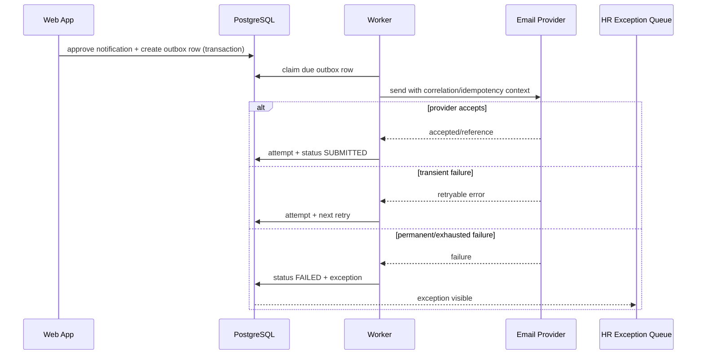

# Document and Notification Design

## 1. Purpose

The DMAIC describes “AI-generated” letters and emails. The product baseline instead uses controlled templates, explicit data mapping, preview, approval and reliable dispatch. This meets the speed and consistency objective with lower privacy, legal and operational risk.

## 2. Controlled template model

Each template type has immutable versions.

Required metadata:

- stable template code;
- document/notification type;
- supported departure types;
- owner;
- classification;
- language/locale;
- effective date;
- status;
- placeholder schema;
- approved recipient/purpose for notifications;
- render channel/format;
- approver and approval time;
- source/legal/policy version reference;
- checksum.

Configuration status:

```text
DRAFT -> PENDING_APPROVAL -> APPROVED -> ACTIVE -> RETIRED
```

Only active versions are selected for new work.

## 3. Placeholder schema

Example:

```yaml
template_code: RESIGNATION_ACKNOWLEDGEMENT
version: 1
classification: RESTRICTED_HR
placeholders:
  employee_full_name:
    type: string
    required: true
    source: employee_snapshot.full_name
  employee_address_block:
    type: multiline_string
    required: false
    source: case.approved_address
    visibility: HR_ONLY
  received_date:
    type: date
    required: true
    source: case.received_at
    format: "MMMM d, yyyy"
  confirmed_last_working_date:
    type: date
    required: true
    source: case.confirmed_last_working_date
  signatory_name:
    type: string
    required: true
    source: template_signatory_config
```

Rules:

- placeholders are allow-listed;
- template code cannot execute arbitrary code;
- required fields block generation;
- date/currency formatting is explicit;
- HTML/text output is context-encoded;
- source and rendered value are shown during approval;
- sensitive optional fields must not appear unless the template explicitly permits them.

## 4. Document lifecycle

1. user selects eligible document type;
2. system resolves active template version pinned to case/workflow;
3. validation checks required fields and departure compatibility;
4. system renders a preview;
5. user submits for approval;
6. approver reviews content, sources and classification;
7. approval creates immutable rendered bytes;
8. issue records file hash, template/data versions and actor/time;
9. optional notification attaches or links the issued document;
10. corrections create a new document and supersession chain.

## 5. Document types

Initial controlled types:

- resignation acknowledgement/acceptance;
- immediate-resignation acknowledgement;
- termination document placeholder pending approved wording;
- digital Employee Action Form;
- asset acknowledgement/clearance summary;
- final offboarding clearance summary.

The system must not invent termination wording.

## 6. Digital Employee Action Form

The source image on page 23 contains multiple HR actions, prior/new status, pay information, checklist and approval lines. For this offboarding product:

- preserve the existing resignation/termination approval authority;
- capture only fields required for offboarding;
- use structured data and authenticated attestations;
- provide an export/print view approximating the current approved form if required;
- do not expose salary/pay fields to roles that do not need them;
- do not treat the form as the sole source of task completion when the platform has more precise evidence;
- changes to signatories require change control.

## 7. Notification composition

A notification is prepared from:

- approved notification template version;
- approved recipient configuration;
- case/employee snapshot and task facts;
- applicability result;
- scheduled/due time;
- approved attachments;
- content/recipient snapshot.

The preview must show:

- To/CC/BCC;
- purpose and classification;
- employee/case identifier appropriate to the recipient;
- effective date/time;
- template version;
- attachments;
- scheduled send time;
- fields omitted due to minimization.

## 8. Approval model (revised by DEC-066, 2026-09-22)

### One approval: the case

The HR Manager approves the offboarding case once, on a Case Approval
Summary that shows the communication plan (every audience with its resolved
destination and readiness), the documents and forms the case will produce,
the benefits and providers selected at intake and the workflow that follows.
That approval authorizes the assigned HR Officer to execute all of it. No
per-document or per-notification HR Manager approval exists.

### Human release required (never automatic)

The HR person executing the approved case - the assigned HR Officer or the
HR Manager - releases each of these by hand, under the case approval:

- employee-facing messages;
- NCB/Sagicor/external providers;
- termination-related messages (restricted cases are also timing-held);
- letters/documents (finalized in one attested step, then issued);
- corrected/resend messages;
- any manual free-form exception.

### Potentially automatic after approved workflow activation

- internal task reminders;
- escalation reminders;
- survey day-7 reminder;
- technical notifications with no additional sensitive content.

Even automatic messages use approved templates, recipient configuration, outbox and audit.

## 9. Notification outbox

Logical flow:



## 10. Idempotency

Recommended logical key:

```text
case_id
+ notification_type
+ recipient_normalized
+ workflow_version
+ effective_event_version
+ dispatch_sequence
```

A deliberate resend increments `dispatch_sequence` and requires reason/approval.

## 11. Attempt and delivery evidence

Store:

- attempt number;
- started/completed time;
- provider;
- provider reference;
- response category/status;
- retryable flag;
- sanitized error;
- next retry;
- correlation ID.

Business status mapping:

| Provider/result | Domain status |
| --- | --- |
| Draft only | DRAFT/PENDING_APPROVAL |
| Approved for future | SCHEDULED |
| Worker claimed | QUEUED |
| API accepted (for example HTTP 202) | SUBMITTED |
| Confirmed delivery signal | DELIVERED_IF_KNOWN |
| Bounce/non-delivery signal | BOUNCED |
| Permanent/exhausted failure | FAILED |
| HR recorded manual send | linked MANUAL_FALLBACK evidence |

## 12. Minimum-data field matrices

### IT access-removal notification/task

Allowed baseline fields:

- employee name;
- employee number/work identity where needed;
- department/location;
- exact effective revocation time;
- systems/accounts/technology assets;
- task/case reference.

Not allowed by default:

- resignation letter;
- personal email/address;
- exit reason/free text;
- survey data;
- pay/benefit data;
- rehire eligibility.

### Finance task

Allowed baseline fields:

- employee identity/number;
- approved departure type category where needed;
- confirmed last day/effective date;
- pay-cycle/reference fields approved by Finance;
- authorized exception decision reference.

Not allowed by default:

- exit feedback;
- broad HR notes;
- technology access details.

### NCB/Sagicor

Allowed field set is OPEN pending owner/privacy approval. Recommended minimum:

- employee identifier/name required by provider;
- programme/group reference;
- approved effective removal date;
- company contact/reference.

No reason, survey data or unrelated contact details.

## 13. Content correction and recall

- submitted email cannot be edited in place;
- corrections use an explicit correction/resend notification;
- the original remains in history;
- recipient impact is assessed;
- an exception records wrong recipient/content;
- template/integration may be suspended if systemic;
- manual recalls are not represented as guaranteed successful unless evidence exists.

## 14. Optional AI assistance

AI may later propose:

- placeholder values extracted from uploaded text;
- draft wording within approved template slots;
- de-identified aggregate themes.

The system must visually distinguish suggestions from approved data/content. Human confirmation writes the final value; the AI output itself is not authoritative.

## 15. Directive 6.3 delta (2026-08-16): email-first department actions

Product direction: HR operational feedback (DEC-045..DEC-049). The
controlled-template discipline above is unchanged; this section records how
notifications become the department action channel.

### 15.1 Derived preparation and send control levels

- The rules engine derives which notifications a case needs (IT access
  removal, Finance offboarding, provider removals per confirmed benefits
  applicability) and prepares each from the ACTIVE template version with a
  full field snapshot, checksum and idempotency key (case + type +
  recipient class + workflow version + effective event) - re-derivation
  reuses a live record and never duplicates.
- Release is governed by configurable send control levels per type
  (`notifications.sendControl`): AUTO_SEND (seeded for internal
  departments; zero HR clicks when every condition holds),
  HR_REVIEW_THEN_SEND (seeded for external providers), and
  HR_MANAGER_APPROVAL_REQUIRED. RESTRICTED cases resolve to the stricter
  of the configured level and the restricted override (default
  HR-Manager approval).
- AUTO_SEND requires ALL of: an approved and verified recipient, an ACTIVE
  template, rendered content with no missing fields, confirmed
  applicability - plus the retained safety gates (record purpose, cohort,
  `automation.notifications` flag). Any blocker opens an AUTO_SEND_BLOCKED
  exception; a missing recipient opens RECIPIENT_MISSING (HIGH) - never a
  silent skip. The DRAFT -> PENDING_APPROVAL -> APPROVED order never
  relaxes; the automatic path is a SYSTEM actor with full audit.
- Confidential timing: termination IT emails carry scheduledSendAt no
  earlier than one hour before the effective instant; termination Finance
  emails the effective instant; the outbox honours the schedule.

### 15.2 Recipients

- The recipient directory gains provider purposes (incl. reserved
  payroll/bank and pension classes), organization and contact names - a
  provider directory, not bare addresses. Directory entries keep the
  approval + verification lifecycle and encrypted, masked destinations.
- A missing recipient is resolved on the case: the assigned HR Officer may
  enter a CASE-ONLY recipient (validated, encrypted, masked, audited)
  without HR-Manager approval; saving for FUTURE cases requires
  recipient-directory authority and the controlled lifecycle (DEC-047).

### 15.3 Evidence chain and acknowledgement tokens

- New statuses SENT -> ACKNOWLEDGED -> CONFIRMED_COMPLETE record the
  evidence chain. Dispatch embeds single-purpose secure links
  (`/ack/<token>`): acknowledge receipt (all email actions) and confirm
  completion (internal departments only). Token discipline mirrors the
  exit-survey tokens: 256-bit CSPRNG, hash-only storage, single-use atomic
  claim, bounded lifetime (72h IT / 14 days otherwise), worker expiry
  nulling the hash, neutral failures, minimum disclosure (action label +
  the case reference the email already carried).
- An HR-recorded evidence path (confirmed by email/phone/other, mandatory
  note, audited with the actor) always exists, so a recipient who never
  clicks cannot stall a case.
- Delivery is never completion: an IT access-removal email that is sent but
  unconfirmed at the effective instant raises a CRITICAL exception, and the
  v2 clearance gate demands confirmation-grade evidence or an approved
  exception. Provider acceptance remains SUBMITTED, never DELIVERED
  (DEC-034); SENT records capture-provider dispatch only outside
  production.

### 15.4 Notification template management

Versioned plain-text templates per notification type (now nine types,
adding payroll/bank and other-external): officers draft against the
allow-listed placeholder set (no markup, no executable content), preview
and test-send use clearly synthetic sample values and the development
capture only (refused in production), the HR Manager activates with atomic
supersession of the prior ACTIVE version, and every lifecycle step is
audited (TEMPLATE_NOTIFICATION_*). The ACKNOWLEDGEMENT_LINK placeholder is
resolved only at dispatch time; stored snapshots keep a marker, never a
live link.

### 15.5 Email banner image (DEC-067, 2026-09-23)

Every dispatched email has two parts. The **plain-text part** is the
template body exactly as before - complete on its own, links included - so
a client that blocks images loses nothing. The **HTML part** is built at
dispatch from that same outgoing text (after any rehearsal redirect):
paragraphs with the URLs turned into links, spacing, then the banner as a
normal `` (`display:block; width:100%; max-width:<own width>px;
height:auto`, concise alt text). The banner is a supplied JPG graphic kept
in object storage (`branding/` keys, checksummed); the platform never
recreates it from text, never crops or stretches it, and never uses it as a
CSS background.

Delivery was evaluated in the directive's order: a **hosted HTTPS URL** is
used when the HR Manager configures one; otherwise the image travels
**inline by Content-ID** (Microsoft Graph: an inline file attachment), which
works with any provider and depends on no host. No Base64 image is embedded
in the HTML.

Which banner: a **personal** banner (My Settings) only where the template
carries the HR sender block and is signed by the case's assigned officer;
otherwise the **department** banner (Administration → System → Email
banner); otherwise none. A banner that cannot be read is logged
(`email_banner_unavailable`) and skipped - the email still goes. The
development capture stores the HTML part and the banner reference so
`/dev/mailbox` shows the complete presentation.

### 15.6 Signature requests and signing links (DEC-068, 2026-09-23)

A **signature request** is a long-lived, revocable invitation for one named
signer to sign one Employee Action Form version. Creating it is not sending
it: HR may Copy Signing Link and share it through another approved channel,
or Send by Email, and both address the same request. Resend Email reuses the
live request rather than issuing a competing one, so a signer who kept the
first message is never left with two links.

**Lifetime** is configuration, not a constant in signing logic:
`signature.linkValidDays` (default 30) sets the window and
`signature.linkMaxDays` (default 90) caps it, including extensions, measured
from when the request was issued. Both live in SystemConfig and are neutral
about hosting and email provider. A link ends at the earliest of completion,
revocation, supersession of the form version by a material case correction,
or its expiry; it is unaffected by worker restarts, redeploys or the signer
closing their browser. Extend Link adds 7, 14, 30 or a chosen number of days
and is audited with the previous and the new expiry. Extending an **expired**
request reactivates it on the same link, which is what "please send me a new
one" usually means in practice; revocation and completion are final and
cannot be reversed.

**Token handling** reuses the platform's existing primitives: a 256-bit
CSPRNG value whose sha256 hash is stored for lookup. Because a long-lived
link must also be copyable and re-sendable, the raw value is additionally
held encrypted at rest with the same AES-256-GCM box that protects recipient
destinations. Completion and revocation destroy that ciphertext, so nothing
reusable survives a final state; expiry, which the owner asked to be
reversible, keeps it recoverable while refusing every use. The one-way hash
is retained throughout, only so a returning signer is told accurately that
the request was completed, expired or revoked. The raw value never reaches
an audit event, a log, a stored email body or an analytics payload. Copy
Signing Link is an authorized POST that returns the link in its response body
for the browser to copy; a redirect carrying it as a query parameter would
put it in the address bar, the browser history and the server request log, so
that route is not used.

**The email** follows the same rule as the acknowledgement links: the stored
body keeps the marker `[signing link inserted at send time]`, and the outbox
resolves the live URL into the outgoing message at dispatch. A request that
ended in the meantime fails the send rather than mailing a dead link. The
`SIGNATURE_REQUEST` template carries the employee's first name, the document
title, the link, its expiry date in words, the case reference and the HR
sender block, so it also carries the sender's banner under section 15.5.
