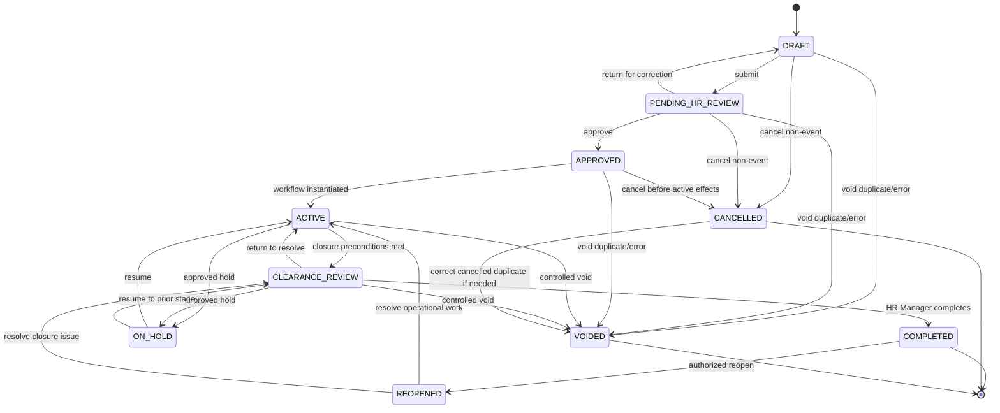
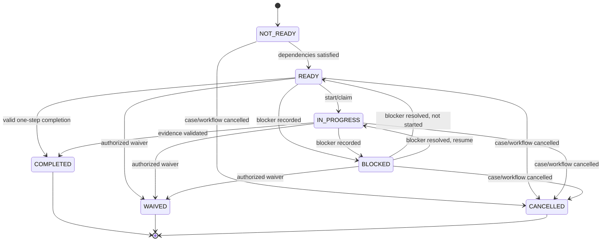
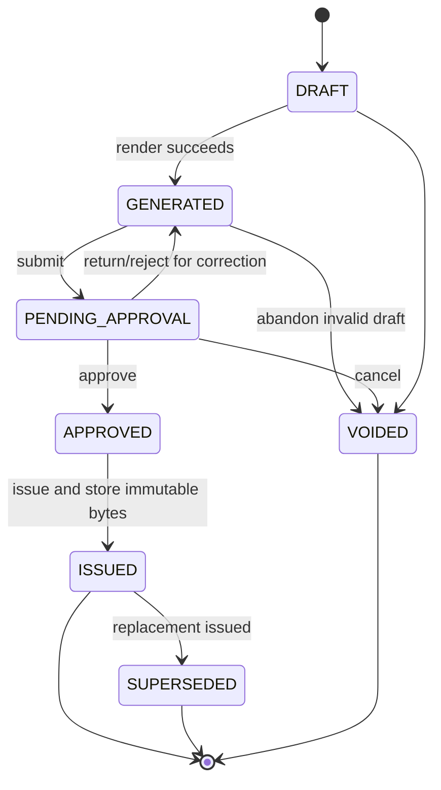
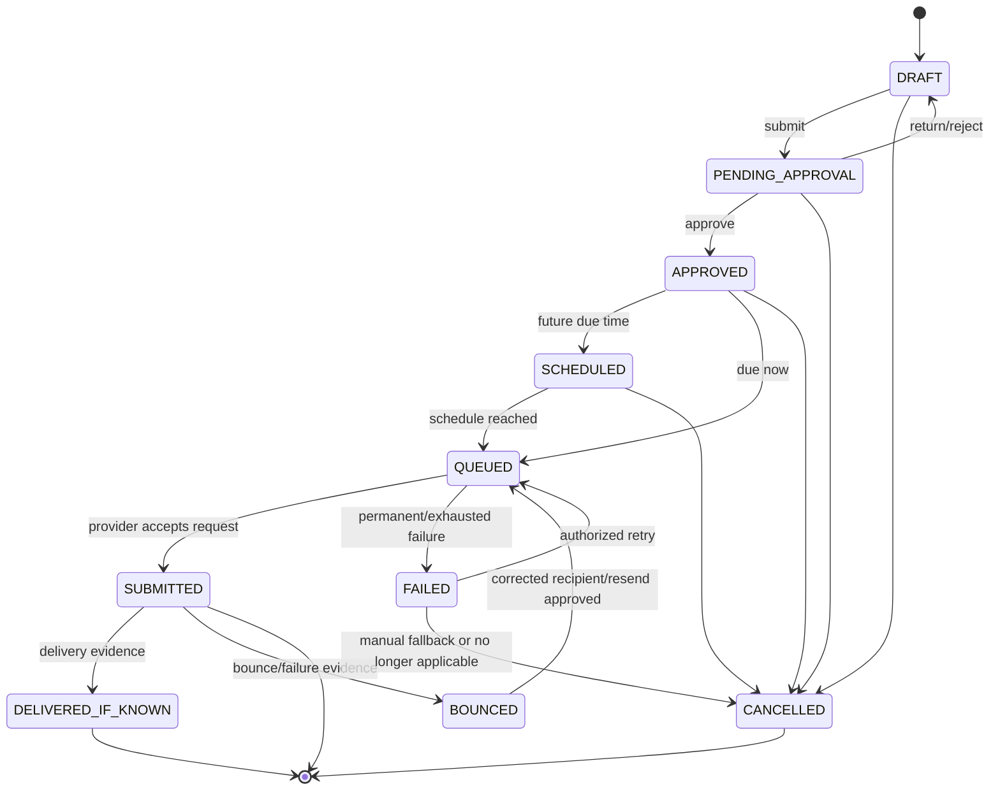
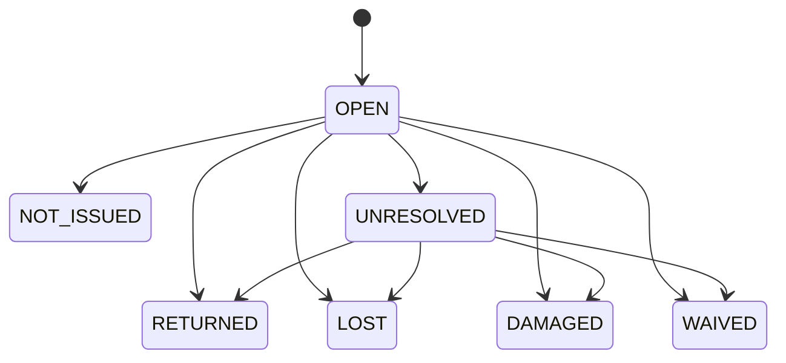
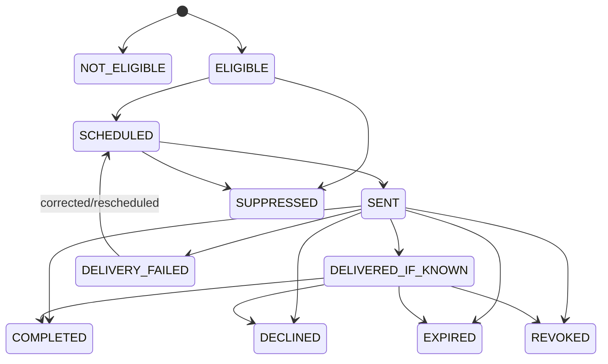
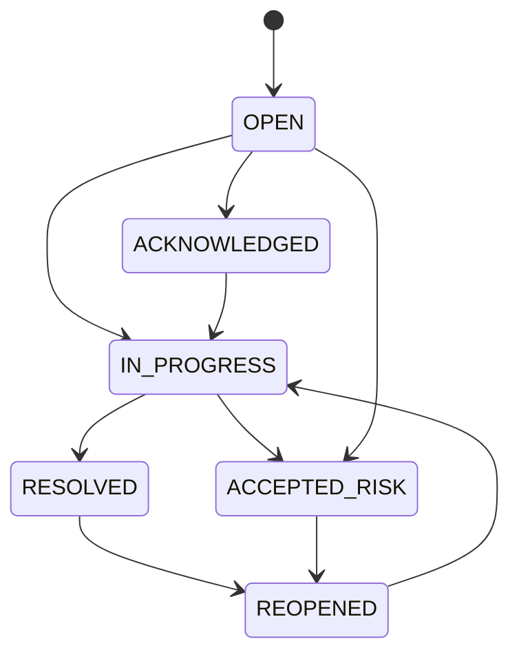

# State Machines

## 1. Case state machine



### Case transition rules

| From | To | Actor/authority | Preconditions | Effects |
| --- | --- | --- | --- | --- |
| DRAFT | PENDING_HR_REVIEW | HR Officer/Manager | Required intake fields valid; source files clean | status history and review task |
| PENDING_HR_REVIEW | DRAFT | HR Manager/reviewer | Return reason | review comments; no workflow |
| PENDING_HR_REVIEW | APPROVED | HR Manager | Employee/date/type/classification validated | immutable snapshot; approval |
| APPROVED | ACTIVE | System | workflow instantiated exactly once | tasks and schedules created |
| ACTIVE | CLEARANCE_REVIEW | HR Officer/system command | mandatory tasks terminal or validly waived; assets have final dispositions; effective-time rules satisfied | closure report generated |
| CLEARANCE_REVIEW | COMPLETED | HR Manager | closure integrity passes; no unresolved blocking exception | completion timestamp/event |
| CLEARANCE_REVIEW | ACTIVE | HR Manager | identified deficiency | new/reactivated tasks as explicit actions |
| ACTIVE/CLEARANCE_REVIEW | ON_HOLD | HR Manager or configured HR role | reason, review date, pause policy | pause event; scheduled effects handled per rule |
| ON_HOLD | prior operational state | authorized HR | resume reason; schedule preview | append recalculation history |
| DRAFT/PENDING/APPROVED | CANCELLED | HR | case no longer proceeds; reason | cancel pending future work |
| any non-terminal operational | VOIDED | HR Manager | duplicate/error and reason | cancel pending effects; retain all history |
| COMPLETED | REOPENED | HR Manager | reason and target state | preserve prior completion; create reopen event |
| REOPENED | ACTIVE/CLEARANCE_REVIEW | HR Manager | explicit target and needed work | new/reopened work recorded |

### Forbidden shortcuts

- DRAFT directly to ACTIVE or COMPLETED.
- PENDING_HR_REVIEW directly to COMPLETED.
- ACTIVE directly to COMPLETED.
- ON_HOLD directly to COMPLETED.
- COMPLETED back to DRAFT.
- any user-facing hard delete.

## 2. Task state machine



Rules:

- `NOT_READY` tasks are visible for planning only to authorized users and cannot be completed.
- a task may be completed directly from READY when its type does not require start tracking.
- `BLOCKED` requires category, explanation, owner and expected resolution.
- `WAIVED` requires configured eligibility, approver, reason and evidence.
- overdue is a derived flag, not a state.
- reassignment does not change task state.
- completion/waiver/cancellation is terminal unless the case is reopened through a controlled action that creates a new task or explicit reactivation history.

## 3. Document state machine



Rules:

- `GENERATED` is not sent/issued.
- issued content cannot be edited.
- correction creates a new document linked to the old one.
- the old document becomes `SUPERSEDED` only after the replacement is issued.
- a void does not delete bytes/history where already created and policy requires retention.

## 4. Notification state machine



Rules:

- `202 Accepted` maps to `SUBMITTED`.
- `DELIVERED_IF_KNOWN` is used only with actual evidence supported by the provider/process.
- attempts are append-only.
- manual fallback is a linked evidence path; it does not rewrite a failed attempt as successful.
- date/applicability changes can cancel only unsent notifications; already submitted content remains historical.
- resend creates an explicit reason and new dispatch sequence/idempotency dimension.

## 5. Asset disposition state model

This is primarily a disposition state rather than a workflow state.



Rules:

- `UNRESOLVED` can count as a final disposition only when explicitly approved for closure and linked to an owned exception.
- `RETURNED` requires receipt evidence.
- `NOT_ISSUED` requires source/manual confirmation.
- `WAIVED` requires approval.
- none of these states modifies payroll.

## 6. Survey invitation state machine



Rules:

- eligibility outcome and invitation delivery outcome are separate.
- a completed HR/verbal route can close the feedback outcome without an online invitation.
- token is invalid after COMPLETED, EXPIRED, REVOKED or SUPPRESSED.
- reminders are sent only while eligible, not completed, not suppressed/revoked and before expiry.

## 7. Exception state machine



`ACCEPTED_RISK` requires configured authority and is not equivalent to silently closing the underlying failed business object.

## 8. Configuration version states

Workflow, document, notification and survey definitions should use:

```text
DRAFT -> PENDING_APPROVAL -> APPROVED -> ACTIVE -> RETIRED
```

- only one active version per type/scope/effective period unless an explicit routing rule permits more;
- used versions are immutable;
- retirement prevents new use but preserves existing cases.
