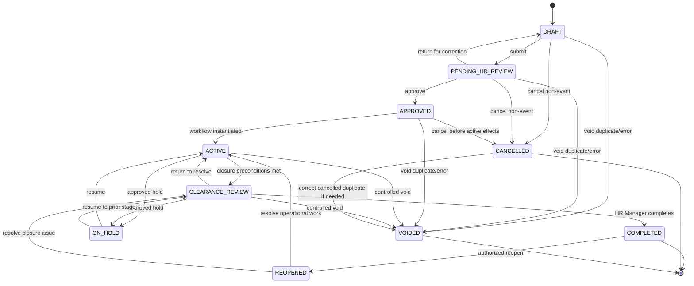
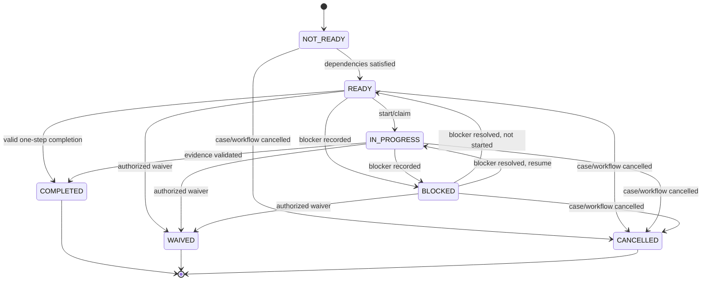
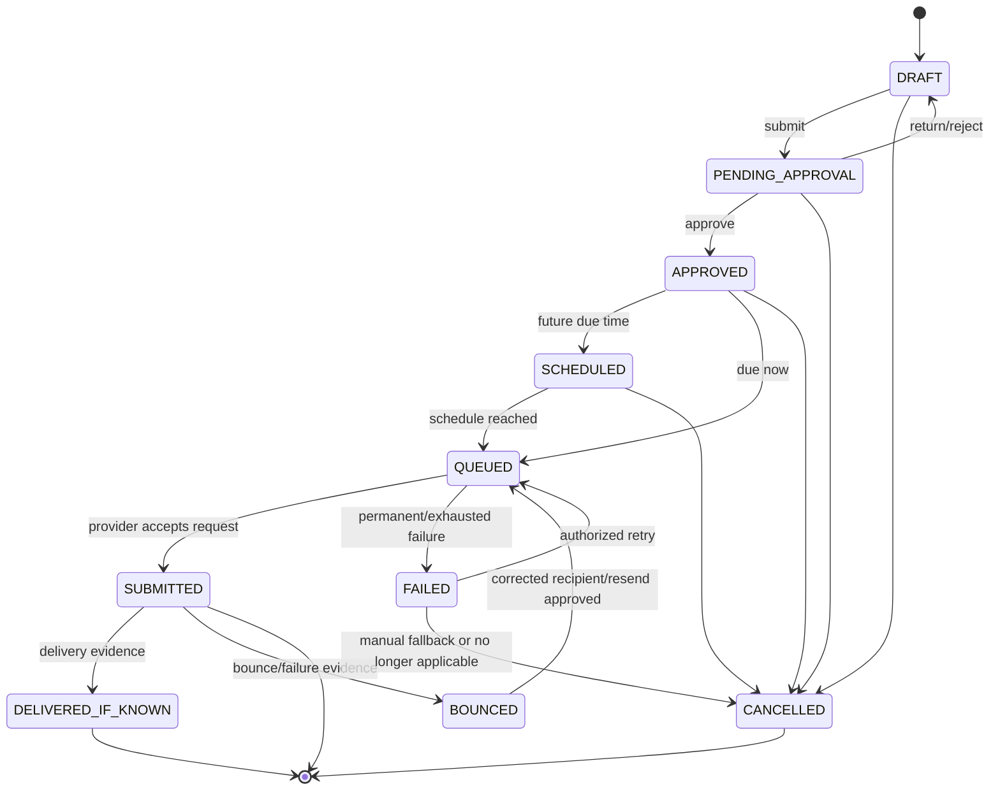
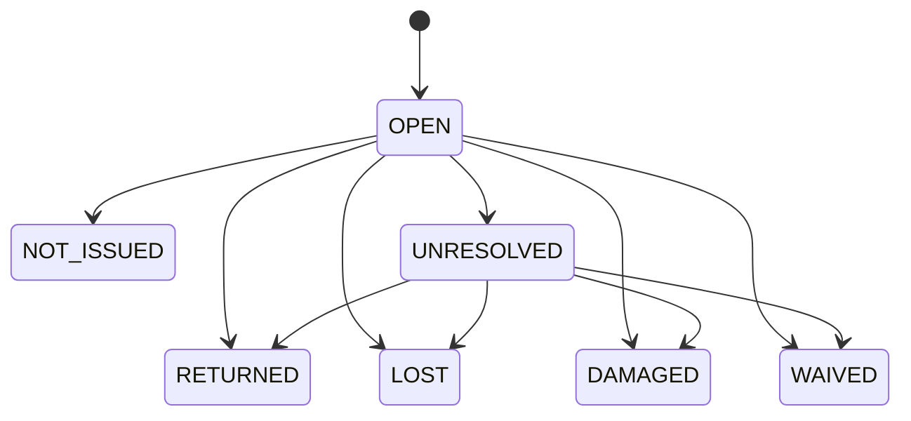
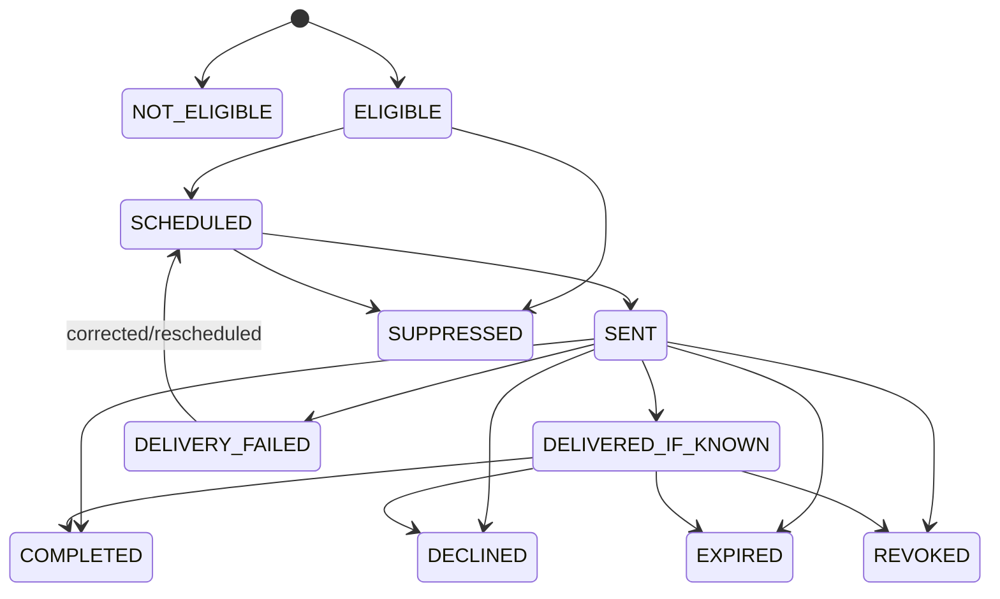
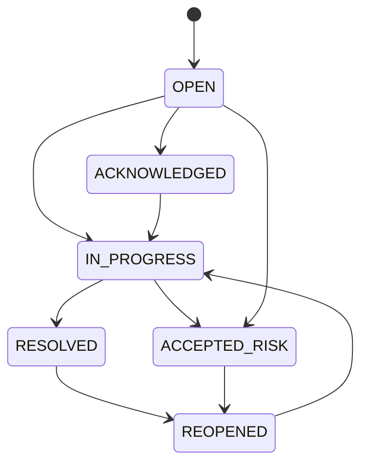
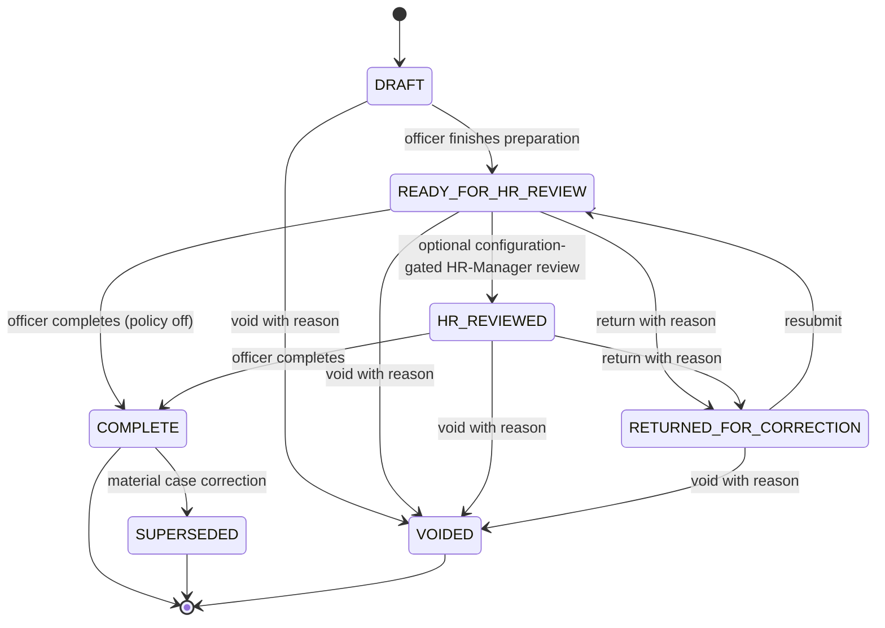
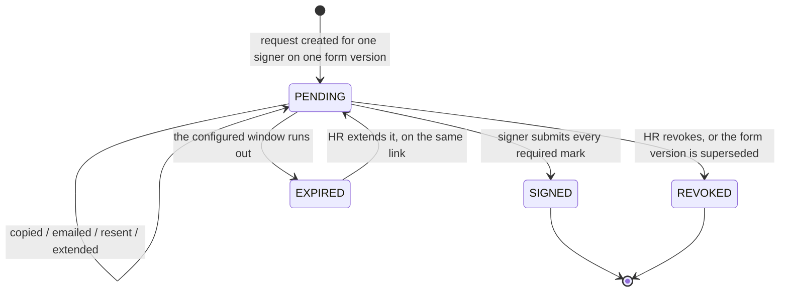

# State Machines

## 1. Case state machine



### Case transition rules

| From | To | Actor/authority | Preconditions | Effects |
| --- | --- | --- | --- | --- |
| DRAFT | PENDING_HR_REVIEW | HR Officer/Manager | Required intake fields valid; source files clean; benefits and providers selected at intake (DEC-066) | status history; submission audited with the case version and approved facts |
| PENDING_HR_REVIEW | DRAFT | HR Manager | Return reason (shown to the officer on the draft) | review comments; no workflow; nothing downstream executes |
| PENDING_HR_REVIEW | APPROVED | HR Manager, on the Case Approval Summary | Employee/date/type/classification validated; the summary shows recipients, documents/forms and the workflow | immutable snapshot; approval audited with version and snapshot checksum; **the single authorization gate**: the assigned HR Officer may now finalize and issue documents, complete forms and release notifications without further HR Manager approval (DEC-066) |
| APPROVED | ACTIVE | System | workflow instantiated exactly once | tasks and schedules created |
| ACTIVE | CLEARANCE_REVIEW | HR Officer/system command | mandatory tasks terminal or validly waived; assets have final dispositions; effective-time rules satisfied | closure report generated |
| CLEARANCE_REVIEW | COMPLETED | HR Manager | closure integrity passes; no unresolved blocking exception | completion timestamp/event |
| CLEARANCE_REVIEW | ACTIVE | HR Manager | identified deficiency | new/reactivated tasks as explicit actions |
| ACTIVE/CLEARANCE_REVIEW | ON_HOLD | HR Manager or configured HR role | reason, review date, pause policy | pause event; scheduled effects handled per rule |
| ON_HOLD | prior operational state | authorized HR | resume reason; schedule preview | append recalculation history |
| DRAFT/PENDING/APPROVED | CANCELLED | HR | case no longer proceeds; reason | cancel pending future work |
| any non-terminal operational | VOIDED | HR Manager | duplicate/error and reason | cancel pending effects; retain all history |
| COMPLETED | REOPENED | HR Manager | reason and target state | preserve prior completion; create reopen event |
| REOPENED | ACTIVE/CLEARANCE_REVIEW | HR Manager | explicit target and needed work | new/reopened work recorded |

### Forbidden shortcuts

- DRAFT directly to ACTIVE or COMPLETED.
- PENDING_HR_REVIEW directly to COMPLETED.
- ACTIVE directly to COMPLETED.
- ON_HOLD directly to COMPLETED.
- COMPLETED back to DRAFT.
- any user-facing hard delete.

## 2. Task state machine



Rules:

- `NOT_READY` tasks are visible for planning only to authorized users and cannot be completed.
- a task may be completed directly from READY when its type does not require start tracking.
- `BLOCKED` requires category, explanation, owner and expected resolution.
- `WAIVED` requires configured eligibility, approver, reason and evidence.
- overdue is a derived flag, not a state.
- reassignment does not change task state.
- completion/waiver/cancellation is terminal unless the case is reopened through a controlled action that creates a new task or explicit reactivation history.

## 3. Document state machine (DEC-066: single authorization gate)

```mermaid
stateDiagram-v2
    [*] --> DRAFT
    DRAFT --> VALIDATION_FAILED: validation fails (fields stale or missing)
    VALIDATION_FAILED --> DRAFT: fields refreshed
    DRAFT --> APPROVED: finalize (attested, checksum-bound; case must be in an execution status)
    APPROVED --> RENDERING: render
    RENDERING --> RENDERED: final bytes stored
    RENDERING --> RENDER_FAILED: worker retries
    RENDERED --> MANUALLY_ISSUED: record manual issue
    RENDERED --> ISSUED_BY_EMAIL: send with PDF attached
    RENDERED --> SUPERSEDED: material case correction or manual supersede
    MANUALLY_ISSUED --> SUPERSEDED: replacement issued
    ISSUED_BY_EMAIL --> SUPERSEDED: replacement issued
    DRAFT --> VOIDED
    APPROVED --> VOIDED
    RENDERED --> VOIDED
    SUPERSEDED --> [*]
    VOIDED --> [*]
```



`PENDING_APPROVAL` and `RETURNED` are legacy statuses of the retired
per-document approval (submit → HR Manager approve → return); a historical row
still in one is editable and finalizes like a draft. No new document enters
them.

Rules:

- finalization is ONE step by the HR person executing the approved case (the
  assigned HR Officer, or the HR Manager intervening): validation, attestation
  (`HR_DOCUMENT_FINALIZATION`), checksum and render. The HR Manager approval of
  the case is the authorization; the audit event `DOC_FINALIZED` names it.
- nothing is finalized or issued unless the case is APPROVED, ACTIVE,
  CLEARANCE_REVIEW or REOPENED.
- `DRAFT` / `APPROVED` (finalized, not yet rendered) are not sent/issued.
- issued content cannot be edited.
- correction creates a new document linked to the old one.
- the old document becomes `SUPERSEDED` only after the replacement is issued.
- a void does not delete bytes/history where already created and policy requires retention.

## 4. Notification state machine



Rules:

- `202 Accepted` maps to `SUBMITTED`.
- `DELIVERED_IF_KNOWN` is used only with actual evidence supported by the provider/process.
- attempts are append-only.
- manual fallback is a linked evidence path; it does not rewrite a failed attempt as successful.
- date/applicability changes can cancel only unsent notifications; already submitted content remains historical.
- resend creates an explicit reason and new dispatch sequence/idempotency dimension.

## 5. Asset disposition state model

This is primarily a disposition state rather than a workflow state.



Rules:

- `UNRESOLVED` can count as a final disposition only when explicitly approved for closure and linked to an owned exception.
- `RETURNED` requires receipt evidence.
- `NOT_ISSUED` requires source/manual confirmation.
- `WAIVED` requires approval.
- none of these states modifies payroll.

## 6. Survey invitation state machine



Rules:

- eligibility outcome and invitation delivery outcome are separate.
- a completed HR/verbal route can close the feedback outcome without an online invitation.
- token is invalid after COMPLETED, EXPIRED, REVOKED or SUPPRESSED.
- reminders are sent only while eligible, not completed, not suppressed/revoked and before expiry.

## 7. Exception state machine



`ACCEPTED_RISK` requires configured authority and is not equivalent to silently closing the underlying failed business object.

## 8. Configuration version states

Workflow, document, notification and survey definitions should use:

```text
DRAFT -> PENDING_APPROVAL -> APPROVED -> ACTIVE -> RETIRED
```

- only one active version per type/scope/effective period unless an explicit routing rule permits more;
- used versions are immutable;
- retirement prevents new use but preserves existing cases.

## 9. Directive 6.3 deltas (2026-08-16, HR-validated workflow)

### 9.1 Action Form state machine (replaces the manager-approval flow for new forms)



Rules (enforced in `packages/domain/src/actionForm.ts`):

- there is NO manager approval and no mandatory HR-Manager sign-off for
  routine completion (DEC-044/DEC-050); `HR_REVIEWED` exists only when
  `actionForm.requireHrReview` is enabled, and then completion from
  `READY_FOR_HR_REVIEW` must pass through it;
- completing requires the acknowledgement recorded (or NOT_OBTAINED /
  NOT_APPLICABLE per departure-type rules) and every HR checklist item
  resolved; completion writes an `HR_FORM_COMPLETION` attestation and
  renders the immutable PDF;
- legacy statuses (`RETURNED`, `PENDING_MANAGER`, `PENDING_HR`, `APPROVED`)
  remain representable forever; legacy live rows may flow forward
  (complete/return) so no historical case is stranded; new rows never enter
  the manager states; legacy `APPROVED` still satisfies clearance;
- superseding a finalized form audits `FORM_SUPERSEDED` (previously
  declared but never emitted - logic review LR-008).

### 9.2 Notification state machine additions (automated evidence chain)

The manual path of section 4 is unchanged and fully supported for
historical records. Directive 6.3 adds the automated chain:

```text
APPROVED --> SENT: outbox dispatch through the capture provider (SYSTEM)
SENT --> ACKNOWLEDGED: secure link redeemed or HR-recorded evidence
SENT --> CONFIRMED_COMPLETE: completion confirmed (internal departments)
ACKNOWLEDGED --> CONFIRMED_COMPLETE: completion confirmed
```

Rules (`packages/domain/src/notifications.ts`):

- `markSent` / `acknowledge` / `confirmComplete` are written only by the
  system (outbox dispatch, token redemption, HR-recorded evidence service);
  the human transition surface refuses them;
- the AUTO_SEND path performs submit → approve as two explicit SYSTEM-actor
  steps - the state order never relaxes;
- derived records snapshot their send control level; a record without a
  recipient shows RECIPIENT REQUIRED and raises the RECIPIENT_MISSING
  exception rather than skipping dispatch (LR-006);
- `SENT` records capture-provider dispatch; provider acceptance is still
  never presented as DELIVERED (DEC-034).

### 9.3 Acknowledgement token lifecycle

```text
ISSUED (hash stored, raw value only in the email)
  --> USED (single-use atomic claim; hash nulled)
  --> REVOKED (re-dispatch supersedes, cancel/supersede/closure; hash nulled)
  --> EXPIRED (worker sweep at expiry; hash nulled)
```

Invalid, used, revoked and expired tokens are indistinguishable to the
public route (neutral failure). Purposes: ACKNOWLEDGE_RECEIPT (all email
actions), CONFIRM_COMPLETION (internal departments only). Lifetimes: 72
hours for IT access removal, 14 days otherwise.

### 9.4 Case-level additions

- **Derived required actions** (`CaseRequiredAction`) carry a
  determination, not a workflow state: DERIVED / DEFAULTED /
  REQUIRES_REVIEW / EXCEPTION / NOT_APPLICABLE, with supersession on
  material fact changes. Display status is projected, never stored.
- **Benefits applicability** on the case: YES / NO / UNKNOWN per benefit;
  UNKNOWN blocks v2 clearance and holds an open exception.
- **Clearance is dual-mode**: instances carrying IT/FINANCE department
  tasks (v1) clear task-based; v2 instances clear from email-action
  evidence (IT: completion confirmed or approved exception; Finance: sent;
  providers: sent where applicable). Unresolved-asset exception coverage is
  per item (LR-007).

## 10. Signature request state machine (DEC-068, 2026-09-23)



Rules:

- **Creation is not delivery.** Copy Signing Link and Send by Email address
  the same PENDING request; a resend reuses it. One live request per signer
  per form version, so two competing links can never exist.
- **PENDING is read against the clock**, so a request whose expiry has passed
  presents as Expired immediately; the worker sweep then ends it formally and
  destroys the reusable token.
- **Extension** moves the expiry forward from the later of now and the current
  expiry, never past the configured ceiling measured from issue.
- **Completion and revocation destroy the encrypted token**, so nothing
  reusable survives a final state. **Expiry keeps it recoverable**: Extend Link
  puts an expired request back to PENDING on the same link, which is what the
  owner asked for instead of forcing a second link. The one-way hash is kept
  throughout, so a returning signer is told accurately which state applies, in
  the owner's wording.
- **Submission is a single atomic claim**: the request flips to SIGNED in the
  same transaction that writes the marks, so a replayed link cannot land a
  second submission or overwrite a signature.
- **Marks belong to the form version they were applied to.** Completion locks
  them; a material case correction supersedes the version and revokes its open
  requests rather than moving marks onto the replacement.
